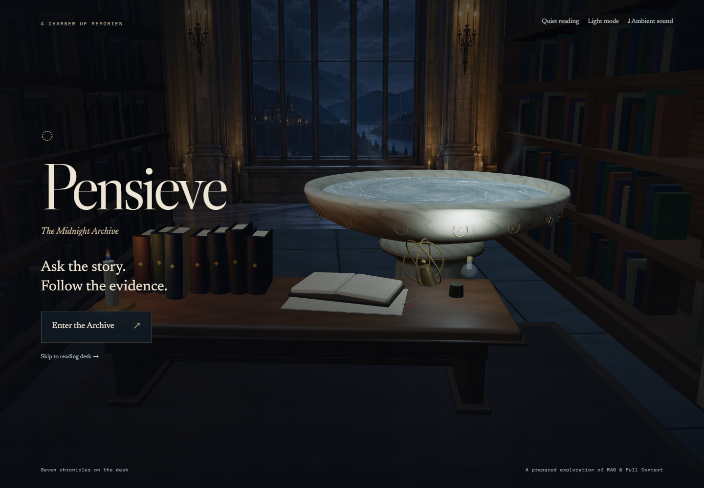
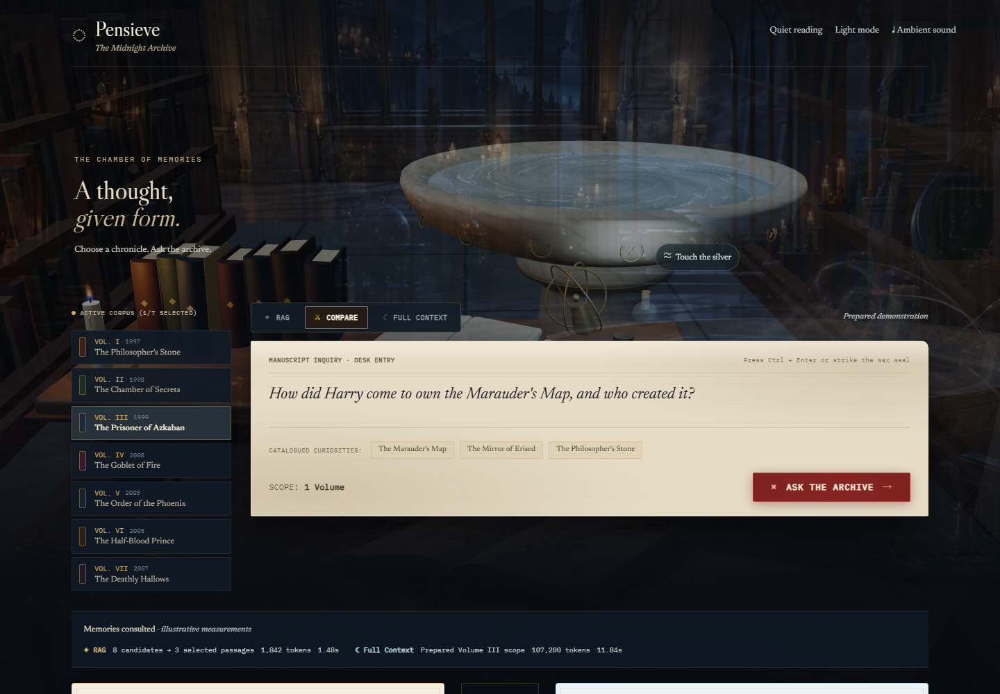
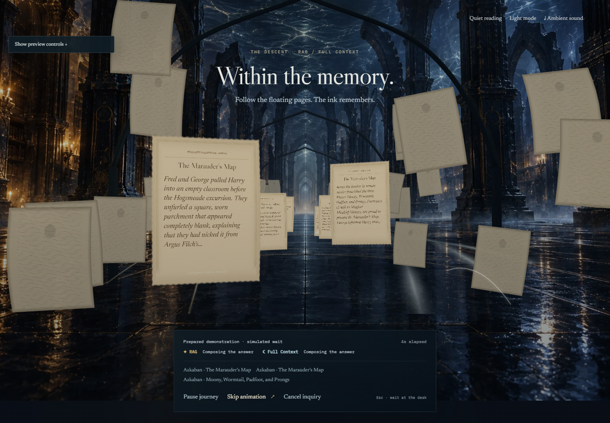
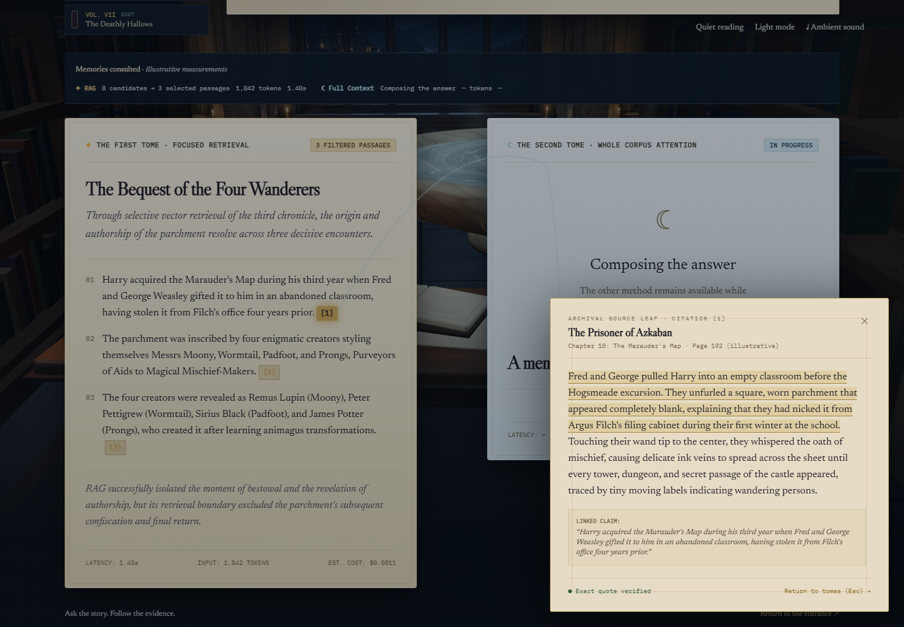

# Pensieve

**An enchanted archive for comparing RAG and Full Context, with every answer connected to its evidence.**

Creative recommendation: **The Midnight Archive** — a candlelit library opening onto a celestial observatory. Two illuminated tomes make the comparison visible; a thread of light connects an answer claim to its source passage.

Status: **the archive has a live Gemini backend and a separate demonstration mode.** Gemini 3.8 Flash generates answers; Embedding 2 and pgvector retrieve passages. Factual answers receive a second review against the supplied sources before publication. The local private corpus contains the complete first three books, with 738 indexed chunks. The browser preserves the selected books and chapters and opens exact source passages from persisted runs.

## Enter the archive

With Docker Desktop running, from this folder:

```sh
docker compose up --build -d
```

Open [the cinematic entrance](http://localhost:3000), [the reading desk](http://localhost:3000/ask), or [the FastAPI documentation](http://localhost:8000/docs).

The Compose stack contains Next.js, FastAPI, and PostgreSQL with pgvector. The database uses a named volume. Stop the services with `docker compose down`; the database volume is retained.

> **Instant Demo (No Docker/API key required):** You can also run the 3D client standalone with full offline mock archives:
> ```sh
> cd frontend
> npm install
> npm run dev
> ```
> Then open [http://localhost:3000](http://localhost:3000).

## Current experience

| Threshold & Entrance | Reading Room Desk |
| :---: | :---: |
|  |  |

| Memory Chamber Descent | Source Chamber & Evidence |
| :---: | :---: |
|  |  |

The threshold reveals the archive and offers an immediate path to the desk. Select an illuminated book, write a question on the manuscript, and choose RAG, Full Context, or Compare. Ask the Archive sends a thread into the basin and carries the camera through its silver surface into a memory interior. The first available method releases its reading tome while the other continues. A citation opens its source passage. Skip the animation to keep waiting at the desk, or cancel the inquiry separately.

The room displays seven volumes. In live mode, only imported books and chapters are selectable. The local authorized corpus covers Volumes I–III; Volumes IV–VII remain unavailable. When live mode is disabled, prepared examples are explicitly labeled as demonstrations.

Live mode uses real retrieval, generation, provider token usage, and PostgreSQL persistence. Quotation locations are checked against the original supplied ranges; the additional model review assesses semantic support. Paid-tier cost estimates are accounting bounds, not proof of a charge. Demonstration mode retains simulated answers and metrics.

Whole-book Full Context reached provider quota/service errors during the free-tier verification. The local frontend therefore limits Full Context input to 30,000 provider-counted tokens and offers a three-chapter shortcut. RAG can search all three imported books. See the [verification report](docs/verification/live-gemini-2026-10-11.md) for measured results and limits.

## Repository

```text
frontend/             Next.js, TypeScript, Tailwind, Motion, components, browser tests
backend/app/          FastAPI, contracts, original sources, mock engine, citations, repositories
backend/app/pipelines/ PDF ingestion, retrieval, generation, and source validation
contracts/            Exported OpenAPI schema
infra/                PostgreSQL and pgvector initialization
scripts/              Contract export
docs/                 Product plans, decisions, experience notes, screenshots
compose.yaml          Three-service local stack
```

## Development

Use Python 3.12+ and Node.js 22+. From `backend/`:

```sh
python -m venv .venv
```

Activate `.venv\Scripts\Activate.ps1` in PowerShell, or `source .venv/bin/activate` on macOS/Linux, then:

```sh
pip install -r requirements-dev.txt
uvicorn app.main:app --reload --host 127.0.0.1 --port 8000
```

From `frontend/` in another terminal:

```sh
npm ci
npm run dev
```

Backend checks: `ruff check app tests` and `pytest -q`. Frontend checks: `npm run typecheck`, `npm run lint`, and `npm run test:e2e` with the services running. Browser tests use an installed Google Chrome in an isolated headless profile. `BASE_URL` can target a different local frontend port. The production frontend is compiled during the Docker build.

To regenerate contracts, run `python scripts/export_contracts.py` from the root using the backend environment, then `npm run contracts` in `frontend/`. The Pydantic models own the wire format; rendering components use aliases of generated types.

## Experience notes

The native production build uses `npm run build` followed by `npm start` in `frontend/`. Its standalone launcher includes the required public/static assets and binds to [127.0.0.1:3000](http://127.0.0.1:3000/). `PENSIEVE_HOST` and `PENSIEVE_PORT` can override that local binding.

Browser coverage includes automated accessibility scans, progressive methods, interruptions, exact citations and laboratory performance samples. Current implementation details and verification are recorded in [the descent report](docs/descent-implementation.md). Laboratory samples do not certify field Core Web Vitals or actual mobile GPU performance.

The local database runs in Docker and the application can run natively. Docker Desktop's temporary inference socket was recovered without removing the database volume. Building and running the complete container stack remains a separate deployment check.

- [Immersive upgrade, references, and verification](docs/experience-upgrade.md)
- [Descent preview with adjustable delays and failures](http://localhost:3000/lab/descent)
- [Cinematic descent implementation](docs/descent-implementation.md)
- [Original artwork and exact generation prompts](frontend/public/art/README.md)
- [Desktop entrance screenshot](docs/screenshots/entrance-desktop.png)
- [Desktop reading room screenshot](docs/screenshots/ask-desktop.png)
- [Source chamber screenshot](docs/screenshots/evidence-desktop.png)

Reduced motion, keyboard navigation, visible focus, mobile tabs/stacking, native dialog behavior, and quiet reading are part of the interface. No sound plays automatically. The Midnight Archive aisle is a WebGL scene that starts on a conservative pixel-ratio, shadow, and particle budget until a desktop GPU tier is known; the research desk stays in the DOM.

## Read the plan

- [Product concept, three creative directions, pages, and components](docs/product-and-design.md)
- [Architecture, source provenance, comparison protocol, and evaluation](docs/architecture.md)
- [Phased roadmap and the first implementation slice](docs/roadmap.md)
- [Architecture decisions and their trade-offs](docs/decisions.md)

## The experience

Enter the archive. Choose the books or chapters to consult. Ask a question. Open one tome for RAG, one for Full Context, or both for comparison. Follow a citation back to an edition-specific passage. Inspect the context, latency, token usage, and estimated cost behind the answer.

The working product name is **Pensieve**; **The Midnight Archive** is its visual direction. Harry Potter is the intended first literary corpus. The artwork and interface will use an original wizarding setting.

## Working assumptions

- A solo-developer portfolio project with a modest public demo audience.
- Next.js, TypeScript, Tailwind, and Motion own the interface; FastAPI/Python own source, experiment, and AI responsibilities; PostgreSQL with pgvector is the backend data boundary.
- Live generation is pinned to Gemini 3.8 Flash and indexing to Gemini Embedding 2. Availability and quota depend on the configured Google project.
- The supplied PDF is private. Source pages identify that PDF, rather than claiming a printed edition's pagination. Only the first three complete books are authorized for live processing in the current local corpus.
- Small original fixtures support the separate functional demonstration.
- Live runs and recorded demonstrations will carry explicit labels; benchmark conclusions will come from measured experiments.

Planning date: **5 October 2026**.

## License & Disclaimer

This project is licensed under the [MIT License](LICENSE).

> **Disclaimer:** This is a non-commercial educational and portfolio project. "Harry Potter" and related elements are trademarks of and © Warner Bros. Entertainment Inc. and J.K. Rowling.

