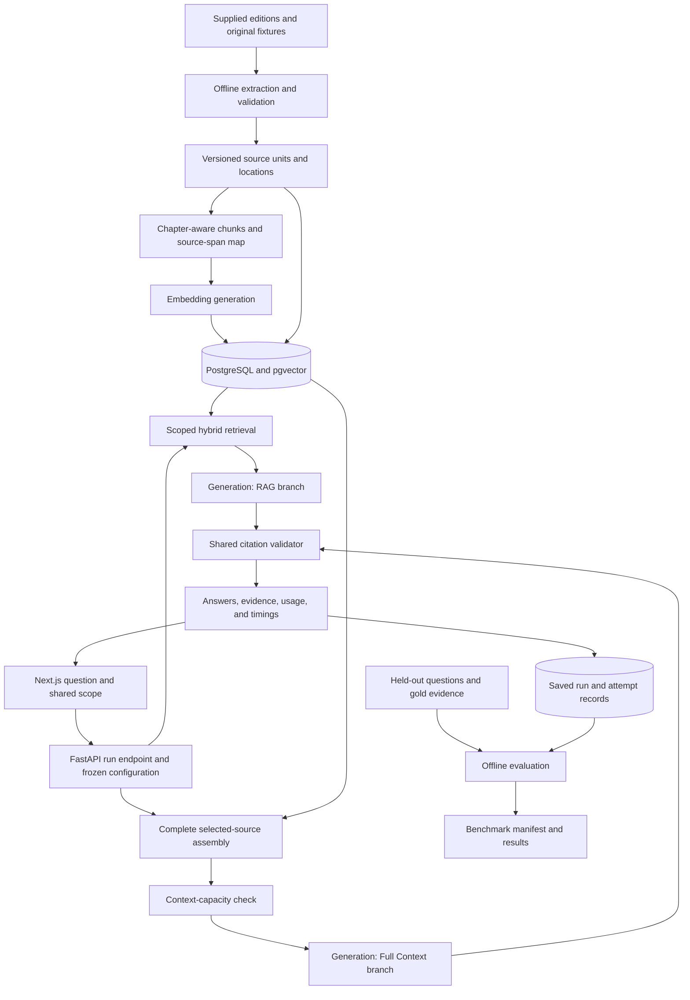

# Pensieve: architecture and experiment design

## Goals and assumptions

Build a source-grounded literary question-answering application that compares RAG and Full Context under a shared, inspectable experiment configuration. The initial deployment is a small portfolio application maintained by one developer. Source reliability and a compelling reading experience take priority over infrastructure breadth.

The first slice implements Next.js rendering, separate FastAPI contracts and experiment services, exact source matching, and demonstration runs. PostgreSQL stores snapshots in Compose. Retrieval, generation, timing, and usage are mocked; Harry Potter ingestion, live providers, and measured benchmarks remain later milestones.

## Suggested stack

| Concern | Initial choice | Reason and trade-off |
| --- | --- | --- |
| Frontend | Next.js App Router + TypeScript | Reading and interaction, with a thin same-origin transport to FastAPI |
| Backend | FastAPI + Python | Source, AI, citation, experiment, and evaluation responsibilities have a separate modular application boundary |
| Styling | Tailwind CSS + CSS custom properties | Shared theme tokens with deliberate component styling; custom artwork and reading composition carry the identity |
| Animation | Motion + CSS/SVG | Focused reveals and evidence transitions with reduced-motion support; continuous ambiance stays lightweight |
| Relational and vector storage | PostgreSQL + pgvector | Source records, run records, lexical search, and vector search in one database; explicit SQL makes retrieval inspectable |
| Data access | psycopg with explicit SQL | A JSONB snapshot store for the first slice; source/retrieval migrations follow with ingestion |
| Generation | OpenAI Responses API behind a narrow provider adapter | Streamed answers and reported usage; adapters must explicitly declare capabilities rather than assume compatibility |
| Embeddings | Configurable provider/model/dimension | Freeze embedding configuration with the corpus version; re-embed when it changes |
| Ingestion | Offline Python modules and CLI | Page extraction, semantic chunking, embeddings, and source mapping belong to the backend |
| Evaluation | Offline CLI plus stored run manifests | Reproducible and independent of browser sessions or request-duration limits |
| Original files | Local private storage initially; private object storage later | Durable provenance without putting entire source files into browser bundles |
| Verification | Focused unit/integration checks and Playwright journeys | Prove source mapping, fair context assembly, streaming behavior, and accessible interactions |

Next.js Route Handlers support request/response endpoints and streaming through Web APIs, making them suitable for the initial server interface. See the [official route-handler documentation](https://nextjs.org/docs/app/api-reference/file-conventions/route).

pgvector can be combined with PostgreSQL full-text search and rank fusion. Start with exact vector search for the small pilot corpus; add approximate indexing after measuring query performance and recall. See [pgvector's retrieval documentation](https://github.com/pgvector/pgvector#hybrid-search).

The runtime is a Next.js frontend, modular FastAPI backend, and PostgreSQL/pgvector database, runnable through Docker Compose. Next.js routes forward HTTP requests and do not retrieve documents, construct prompts, or generate answers. The mock slice creates run snapshots and polls independent branch states. A worker or event stream can be introduced when real ingestion and generation require it, preserving the run/claim/citation rendering contract.

## System overview



Gold answers and gold evidence are available to the evaluator after generation. They are kept outside the retrieval index and generation prompts.

## Ingestion and exact source provenance

1. Register the source title, edition, language, file checksum, format, and corpus version. Validate the source set before creating an index.
2. Extract ordered text while preserving page boundaries. Keep the original source representation and a canonical text representation, with a reversible location map between them. OCR uncertainty and normalization changes are recorded.
3. Detect chapters and inspect a sample of boundaries manually. Check suspicious boundaries and pages with missing or unusually short text.
4. Store immutable source units with stable identifiers, ordered text, chapter membership, canonical offsets, and original file locations. A page split inside a chapter is preserved.
5. Build paragraph-aware chunks within chapter boundaries. Start around 500–700 tokens with approximately 80 tokens of overlap, then tune on the development questions. These values are initial hypotheses.
6. Map every chunk to one or more source spans. A chunk crossing a page references both pages; overlap does not produce duplicate source units or duplicate citation counts.
7. Embed chunks using the corpus's declared model and dimension. Store a lexical index as well. Check the chosen vector type and index's dimensional limits before creating approximate indexes.
8. Run ingestion audits: source ordering, chapter coverage, page mapping, span bounds, hashes, chunk coverage, and duplicate handling. Publish an immutable corpus manifest when those checks pass.

**Page truth:** a PDF page index is distinct from the page printed on the book. Store a zero-based file index internally and display a one-based “PDF page” label. Printed page labels can be strings, including front-matter numerals. Edition information accompanies every page citation. If a printed-page map has not been validated, display the PDF page only. An EPUB without fixed pagination uses chapter and location identifiers.

**Excerpt truth:** the model selects source references and bounded quote text; the server resolves and validates them. The evidence viewer displays the corresponding canonical span and, when available, the original page crop. A rendered parchment passage is clearly identified as an extracted passage.

The supplied Harry Potter editions are an implementation input that remains outstanding. Begin development with original fixture documents carrying known page/chapter mappings. The repository and any eventual public exports use an explicitly selected corpus-distribution policy; source files remain separate from application assets.

## Shared experiment configuration

One comparison freezes the question, corpus version, edition set, book/chapter selection, generation model version, common instruction version, output schema, generation settings, output limit, and timing policy. The two methods may vary only in how they construct their document context and in their method-specific context wrapper.

Both branches receive the same question and common instruction to answer from supplied sources, cite their claims, and abstain when the evidence is insufficient. Both undergo the same citation validation. Any query rewriting, reranking, extra verification, or follow-up generation is logged as an additional operation with its own time, tokens, and cost estimate.

A selected chapter range is part of the experiment's public scope. It is not chosen secretly by the system after seeing the question. RAG searches only within that scope. Full Context includes every canonical source unit in that same scope.

### RAG branch

- Generate the query embedding, and run vector and lexical retrieval within the frozen source filters.
- For a pilot, retrieve roughly 20 candidates from each channel, combine through reciprocal rank fusion, deduplicate overlapping spans, and select approximately 6–10 chunks within an explicit token budget. Record the exact configuration.
- Preserve selected-source order and attach stable source identifiers to prompt blocks. Log both retrieved candidates and the actual blocks sent to the model.
- Generate the structured answer, stream provisional readable text, validate citations, and finalize the branch.
- Add reranking or multi-query retrieval only after a documented failure case warrants it. Each enhancement becomes a separately versioned RAG variant in the benchmark.

### Full Context branch

- Load all canonical source units in the selected scope, in book/chapter/page order, with stable source identifiers. Do not run question-dependent passage selection.
- Construct the complete request, including source labels, instructions, schemas, and reserved output budget. Count that actual request against the selected model's capabilities.
- If it fits, submit the entire selected text. The context manifest reports selected units, included units, source tokens, and coverage.
- If it does not fit, return a capacity state with actions to choose a smaller visible scope or a compatible model. A RAG-only run remains possible with a clear comparison status.
- A summary, truncated document, or map-reduce answer would be a separate future method, with its own name and measurements.

Full Context is **full within the declared scope**, whether that scope is three chapters, one book, or a set of books. The seven-book collection cannot be assumed to fit a particular model. A benchmark pairs methods only on scopes eligible for both and reports excluded cases separately.

OpenAI documents request context limits and provides input-token counting for the actual request structure. Use those capabilities for preflight, with a conservative fallback only when a compatible provider lacks exact counting. See [context-window guidance](https://developers.openai.com/api/docs/guides/conversation-state#managing-the-context-window) and [input-token counting](https://developers.openai.com/api/docs/guides/token-counting).

## Generation and citation contract

The final response is structured into answer claims and source references. A claim has an ID, readable text, and zero or more citations. A citation proposes a source-unit ID and a bounded quote from that unit. The provider's final structure also permits a declared insufficient-evidence outcome.

The server validates each citation against the run's context manifest:

- The proposed source ID exists in the frozen corpus and was actually sent to that branch.
- The proposed quotation resolves to an exact span after the recorded normalization rules.
- Repeated quotation text is disambiguated through source ID and location; unresolved ambiguity remains unverified.
- Book, chapter, edition, page, and offsets are assembled from source records.
- Claim text and citation relationships survive round-tripping into the saved run.

A structural citation check establishes location and excerpt fidelity. Whether the passage actually supports the claim requires a semantic evaluation, separately labeled as human-reviewed or judge-assisted. A similarity score is a retrieval measure, not a probability that an answer is true.

Streamed text is provisional while final structure and citations are checked. The UI reserves citation positions and displays a “Checking sources” state. A malformed final response is retained as a failed attempt; it does not become a successful verified answer. Repairs are bounded and recorded as extra generation calls.

The trace exposes supplied source blocks, prompt configuration, source checks, and measurements. It does not need private model reasoning to explain how the experiment was constructed.

## Data model

| Entity | Important fields |
| --- | --- |
| `corpus_versions` | manifest hash, extraction version, embedding model/dimension, ingestion timestamp |
| `documents` | title, edition, language, file hash, format, private storage reference |
| `chapters` | document ID, chapter number/title, order, validated boundaries |
| `source_units` | corpus version, chapter ID, canonical text/hash, original location, ordered index |
| `source_spans` | source-unit ID, canonical start/end, PDF index, printed-page label, original-coordinate mapping |
| `chunks` | corpus version, text/hash, tokens, embedding, lexical document, chunking version |
| `chunk_source_spans` | chunk ID, source-span ID, mapped start/end |
| `query_runs` | question, shared scope, model, generation settings, instruction/schema versions, configuration hash |
| `branch_attempts` | run ID, method variant, attempt index, status, supplied-context manifest, provider request ID |
| `answer_claims` | branch attempt ID, claim ID, text, insufficient-evidence state |
| `citations` | claim ID, source-span ID, exact excerpt, structural/semantic validation states |
| `stage_events` | attempt ID, stage, sequence number, monotonic elapsed time |
| `usage_records` | operation, provider usage, cached-input breakdown, estimated price snapshot, status |
| `benchmark_questions` | dataset version, category, scope, held-out split, gold answer/evidence, rubric |
| `benchmark_runs` | question attempts, repetitions, execution/cache policy, scoring version, aggregate manifest |

Store immutable completed attempts. A retry creates a new attempt rather than overwriting the evidence and usage of the old one. Database constraints enforce source relationships; scoped queries enforce context boundaries.

## Server interfaces and frontend state

Proposed endpoints:

- `GET /api/corpora`: available manifests and scopes.
- `POST /api/runs`: validate scope, create the run, and stream branch-tagged events through a fetch-consumed event stream.
- `GET /api/runs/[runId]`: load a recorded run with its attempts, claims, and measurements.
- `GET /api/evidence/[sourceId]`: resolve an allowed excerpt and source metadata against a corpus version.
- `GET /api/benchmarks/[benchmarkId]`: load a stored evaluation manifest and results.

The question request freezes `{question, mode, corpusVersion, documentIds, chapterIds, modelConfigId}`. The server derives permitted provider settings rather than trusting arbitrary client configuration.

Events include `run-created`, `branch-status`, `retrieval-ready`, `answer-delta`, `citation-validated`, `usage-final`, `branch-complete`, and `branch-failed`. Every event carries a run/attempt ID and sequence number. The client can maintain two independent result lifecycles while sharing the question and scope.

Abort propagates when the client cancels. A disconnected or interrupted stream leaves an explicit incomplete/cancelled state. Missing provider usage remains unknown; later reconciliation can update the usage status while retaining the original record. The pilot runs requests within the server's supported lifetime. Move durable generation to a worker if hosting limits or concurrent work require it.

## Metrics and estimated cost

| Measurement | Definition |
| --- | --- |
| Request-to-first-answer | Server request receipt to the first user-readable answer text; includes context preparation |
| Provider first-token time | Generation-call start to first content token; shown separately when measurable |
| Context preparation | Extraction-independent query embedding, retrieval, fusion/reranking, or complete-context assembly |
| Generation time | Generation-call start to provider completion |
| Validation time | Final response receipt to citation-validation completion |
| Branch total latency | Shared request receipt to the verified branch terminal event |
| UI elapsed time | Client-observed duration, labeled separately from server measurements |
| Tokens | Provider-reported input, cached-input, output, and available reasoning breakdowns |
| Source coverage | Source units supplied compared with units selected in scope |
| Citation coverage | Answer claims with source references; separate from semantic support quality |

Use server monotonic clocks for elapsed durations and timestamps for run dates. A loading animation does not determine any measured duration. Unknown fields display “Unavailable,” not zero.

For token-priced generation, using rates expressed per million tokens:

```text
uncached_input = input_tokens - cached_input_tokens
generation_estimate = (
  uncached_input * uncached_input_rate
  + cached_input_tokens * cached_input_rate
  + output_tokens * output_rate
) / 1_000_000

online_run_estimate = sum(generation, query_embedding, reranking,
                          repairs, and configured online validation)
```

Include reasoning according to the provider's billing semantics; do not count it twice if it is already included in output usage. Record model, currency, rate source, and price-snapshot date. Rates and model capabilities are configurable and checked when implementing the provider adapter. Any provider-specific request fees are separate line items. Ingestion embedding cost is a one-time dataset cost and can have an explicitly labeled amortized view.

Reported usage supports the estimate; the result is labeled **Estimated API cost**. It is distinct from an account invoice or hosting cost. Caching details are retained, and missing final usage does not imply a free run. See [OpenAI's usage-field guidance](https://help.openai.com/en/articles/10478918-reviewing-api-usage-and-costs).

## Evaluation and benchmark protocol

Start with 24 manually annotated questions on one validated book or chapter collection: eight factual, eight multi-hop across included chapters, and eight unanswerable in the selected scope. Add a 40-question suite with ten per category, including cross-book questions, when multiple editions are ingested and a complete shared scope fits the selected model.

Each question has a declared scope, gold answer or abstention, one or more acceptable evidence sets, a category, and a rubric. Define a development split for retrieval/prompt tuning and a held-out split for reported results. Mark unavailable categories clearly during the pilot.

| Score | Method |
| --- | --- |
| Correctness and completeness | Human rubric from 0–4, with judge-assisted scores identified separately |
| Citation structural validity | Deterministic checks of source existence, supplied-context membership, and excerpt location |
| Citation precision | Proportion of citations whose passages support their linked claims, judged under the rubric |
| Claim evidence recall | Proportion of evidence-requiring answer claims with adequate supporting citations |
| Gold evidence coverage | Coverage of acceptable annotated evidence units; account for equivalent valid support |
| Retrieval recall at k | Gold supporting units present among RAG's retrieved/supplied candidates, with the stage identified |
| Abstention accuracy | Correct refusals on scoped unanswerable questions and erroneous refusals on answerable ones |
| Latency, tokens, estimated cost | Per-attempt measurements and usage under the recorded execution/cache policy |

Run the initial suite at least three times per method; use five or more repetitions for the published comparison when budget permits. Record all attempts and failures. Display paired question-level outcomes, sample counts, medians, and observed ranges; p95 estimates need enough observations and a visible sample size.

The interactive Compare screen runs both methods concurrently for a responsive experience. The benchmark runs attempts in isolation with counterbalanced method order so resource contention is controlled. Cache state and cached input tokens are recorded; warm and cold observations are not silently pooled. Retries and repair calls retain their time and cost.

The expected trade-offs are hypotheses: RAG may save context tokens and focus citations, while complete context may help with distributed evidence. Retrieval omissions, long-context attention failures, unsupported claims, and incorrect abstentions are all useful case studies. The published page states where each method performed better on this dataset, with uncertainty and configuration visible.

Harry Potter may already be represented in a model's pretraining. Answer correctness alone therefore does not demonstrate successful document use. Require evidence grounded in the supplied edition, score abstention within restricted scopes, and add original fixture documents containing invented facts as a control. This limitation belongs in the experiment methodology.

## Implementation quality and deployment

Keep provider credentials on the server. Scope file/evidence access through corpus permissions. Treat extracted text as data in clearly delimited prompt blocks, validate structured outputs, and render answer text safely. Apply a modest durable rate limit and concurrency limit before a public live demo. Record enough trace detail for reproducibility without exposing keys or private files in public exports.

Important checks: exact excerpt round-trips; correct cross-page metadata; selected-scope enforcement; all selected units included in Full Context; capacity rejection before generation; invalid citation rejection; shared configuration equality; branch independence; usage accounting; and keyboard navigation through the evidence journey.

Begin locally with a supported Node runtime and PostgreSQL with pgvector. Choose deployment after observing full-context request times. A Node container and managed PostgreSQL are an initial option; serverless hosting is also possible if its duration and stream behavior meet the observed requirements. Keep the benchmark CLI outside public request handlers. Provisioning and publishing are later milestones, after the product is reviewable.
