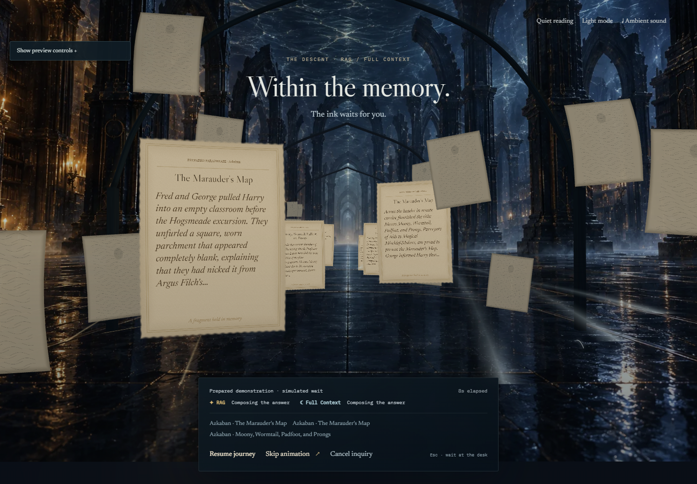

# O Mergulho da Memória — implementação

Implementado em 7 de outubro de 2026, depois do checkpoint `16fd83e` na branch `gabrieljr42/feat/memory-chamber-and-descent`.

## Experimentar

- Entrada: `http://127.0.0.1:3000/`.
- Mesa: `http://127.0.0.1:3000/ask`. Enviar a pergunta preparada pelo botão **Ask the Archive**.
- Prévia controlável: `http://127.0.0.1:3000/lab/descent`. Ajustar o atraso de cada método, escolher uma falha e usar **Start preview**. Essa página permite rever a sequência completa mesmo depois da primeira consulta.

A interface principal identifica a demonstração e a espera simulada. O exemplo preparado padrão entrega RAG em aproximadamente 5,2 s e Full Context em 8,4 s. Esses tempos servem à demonstração da interação; as métricas dos tomos continuam identificadas como ilustrativas. Consultas sem resposta preparada exibem seu resultado vazio imediatamente.

## O que mudou

O selo lança um filamento, a prata afunda geometricamente e a câmera se aproxima do centro real da bacia. A travessia utiliza uma passagem transitória de refração: a sala é renderizada em uma textura, distorcida e coberta pela película prateada. Sob essa película, o mesmo Canvas passa para o cenário interior. A câmera desacelera e permanece estável enquanto a consulta continua.

O espaço interior mistura arquitetura distante em uma arte original com elementos do primeiro plano em 3D: folhas instanciadas com marcas abstratas de tinta, nervuras de arcos, pilares, correntes âmbar e prateadas e iluminação. As marcas nas folhas são ornamentais; os títulos de fontes no painel vêm do resultado recebido. [Arte original e prompt exato](../frontend/public/art/memory-interior-prompt.md).

O passeio durante a espera agora avança entre seis pergaminhos próximos com texto legível. A tinta se revela gradualmente; os trechos vêm das fontes confirmadas no manifesto da execução e a demonstração os identifica como paráfrases preparadas. A pergunta também ocupa um pergaminho. Um percurso suave e limitado mantém a câmera dentro do corredor, inclusive em esperas longas. **Pause journey** permite parar e ler; **Resume journey** retoma o passeio, sem alterar o processamento da pergunta. Os fragmentos também ficam disponíveis em HTML para leitores de tela.

O método escolhido determina quais correntes aparecem. A primeira resposta utilizável libera os tomos em HTML e inicia uma saída visual de aproximadamente 360 ms. Em Compare, o outro tomo mantém seu próprio estado e recebe a resposta quando ela chega. O segundo resultado preserva a câmera, a aba escolhida e um diálogo de fonte que esteja aberto.

O mergulho completo leva aproximadamente 4,4 s enquanto a consulta continua pendente. Nas consultas seguintes, a abertura fica mais curta. Se o conteúdo chega antes, a sequência é encerrada no ponto atual. A apresentação não segura um resultado pronto para completar uma duração mínima.

## Controles e interrupções

**Skip animation** e `Escape` retornam à mesa e mantêm a execução. **Cancel inquiry** invalida a execução atual, preserva a pergunta e descarta respostas tardias. Pergunta, método e seleção são capturados antes de enviar a consulta.

Os controles continuam em HTML durante a travessia; a mesa coberta fica fora da navegação por teclado. A chegada transfere o foco para a leitura. As preferências **Quiet reading**, **Light mode** e `prefers-reduced-motion` podem interromper a sequência sem cancelar a resposta. Uma falha de WebGL conserva formulário, fontes e leitura.

O som continua desligado até ser solicitado. Quando habilitado, a travessia acrescenta uma ressonância e filtra o ambiente; a chegada devolve a sonoridade da biblioteca. Ocultar a aba pausa a apresentação e o áudio. Ao retornar, o cenário assume o estado atual em vez de reproduzir movimentos atrasados.

Após vinte segundos, a atividade visual diminui e o painel mantém o tempo decorrido e o último estado recebido. O cronômetro não produz percentuais nem inventa etapas da IA.

## Execução e transporte

`inquiry/controller.ts` liga uma execução ao diretor, com proteção pelo `requestId`. `InquiryTransport` entrega snapshots progressivos. A demonstração local emite etapas e respostas preparadas com atrasos canceláveis; a página de prévia permite testar as duas ordens de conclusão e falhas individuais.

`createHttpInquiryTransport` oferece uma ponte para a API existente: cria a execução, consulta snapshots a cada 650 ms, reconecta com espera crescente e solicita cancelamento ao servidor quando o acompanhamento é interrompido. O contrato pode receber texto parcial; citações aparecem quando sua estrutura está verificada. Um snapshot de outra execução é rejeitado.

Para uma integração futura, a aplicação pode selecionar esse transporte com `configureInquiryTransport(createHttpInquiryTransport("/api"))` e fornecer corpus, versão e escopo compatíveis com o servidor. A versão entregue continua usando dados preparados. Não foram adicionadas chamadas a um provedor de IA, chaves, ingestão dos livros, SSE ou um processamento real de RAG/Full Context. A API atual também permanece demonstrativa; a animação já tem o ponto de conexão para essa evolução.

## Arquivos principais

| Papel | Arquivo |
|---|---|
| Coreografia interruptível | `frontend/src/features/archive/diveDirector.ts` |
| Execução e proteção de respostas | `frontend/src/features/archive/inquiry/controller.ts` |
| Transporte da demonstração e HTTP | `frontend/src/features/archive/inquiry/transport.ts` |
| Interior e folhas em 3D | `frontend/src/features/archive/scene/MemoryInterior.tsx` |
| Arquitetura distante | `frontend/src/features/archive/scene/MemoryBackdrop.tsx` |
| Refração transitória | `frontend/src/features/archive/scene/MemoryPass.tsx` |
| Estado, foco e ações durante a cena | `frontend/src/features/archive/ui/DiveOverlay.tsx` |
| Estado independente por método | `frontend/src/features/archive/ui/InquiryStatus.tsx` |
| Prévia de tempos e falhas | `frontend/src/features/archive/ui/ArchiveInquiryLab.tsx` |

## Verificação

Build de produção e TypeScript passaram. ESLint, testes de execução e geometria passaram. A versão inicial passou em **27 testes de navegador**, incluindo verificações axe nas vistas de entrada, mesa, fontes e mergulho. Depois de acrescentar o passeio com texto, **13 testes de produção** das cenas, fontes e interrupções passaram novamente, incluindo o novo teste de movimento, pausa e retomada. O teste de execução também confirma que os trechos são prefixos das fontes recebidas e que a trajetória permanece suave e limitada em esperas longas.

Os testes exercitam a travessia da bacia real, a visibilidade do interior, resposta imediata, Full Context chegando primeiro no mobile, pular sem cancelar, cancelar sem aceitar dados antigos, aplicar movimento reduzido durante a passagem e falha de apenas um método. A espera de 90/120 s é verificada com relógio virtual no navegador; isso testa a lógica temporal, sem constituir medição de uso de GPU por dois minutos.

O teste de execução também valida resultados progressivos, preservação de fontes abertas, descarte de snapshots antigos, cancelamento de uma espera de 90 s, reconexão HTTP e solicitação de cancelamento ao servidor. As verificações existentes de acessibilidade, fonte literal, WebGL alternativo, som e layout continuam na suíte.

`frontend/scripts/capture-descent.mjs` salva quadros e contadores em `docs/verification/descent`. As amostras são de Chrome local, sem limitação de CPU. Chamadas de desenho e triângulos não certificam FPS em um celular; a validação em hardware mobile continua necessária antes de afirmar esse desempenho.

O novo backplate tem 240.658 bytes. A qualidade se adapta aos limites de resolução e geometria existentes. O passe adicional é utilizado somente enquanto a película está ativa; a sala normal renderiza diretamente.

A captura do interior antes de acrescentar os pergaminhos escritos, sem a película, registrou **8 chamadas de desenho e 6.668 triângulos**. Os quadros e os dados estão em [verification/descent/frames.json](verification/descent/frames.json), sem erros de aplicação ou shader nessa captura. Trata-se de uma amostra de geometria/renderização local, não de uma garantia de fluidez em todos os dispositivos.

