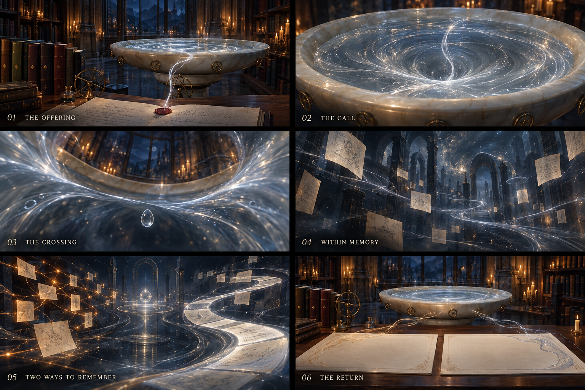

# Pensieve — O Mergulho da Memória

**Plano de 7 de outubro de 2026.** Gatilho: enviar uma pergunta pelo botão **Ask the Archive** ou pelo teclado. Escopo deste documento: direção de animação, experiência de espera e integração necessária. A sequência visual e o controlador de espera foram implementados; [estado da execução e validação](descent-implementation.md). A integração com uma IA real continua dependendo do processamento no servidor.

**Direção escolhida:** a pergunta deixa o manuscrito como um fio de tinta, entra na bacia e conduz a câmera através da prata. Sob a superfície existe um arquivo de memórias. A chegada de uma resposta reorganiza esse espaço e devolve o visitante à leitura.

O ponto alto é atravessar a película do líquido e perceber uma profundidade impossível dentro de uma bacia rasa. A câmera, os materiais e o som precisam fazer esse instante parecer contínuo. A espera posterior tem outro ritmo: sereno, amplo e capaz de durar sem exigir atenção constante.



Imagem conceitual criada com `image_gen`, a partir da aparência atual do site. [Prompt completo e origem](concepts/pensieve-descent-prompt.md). O cenário interior e sua qualidade final serão estabelecidos no protótipo WebGL.

## 1. O filme que acontece depois do clique

Os tempos abaixo são uma proposta de ritmo para uma consulta que ainda está em processamento. Não são duração mínima de carregamento nem etapas presumidas da IA.

| Momento | Imagem e movimento | Som, se já habilitado |
|---|---|---|
| **1. A oferenda — 0 a 0,35 s** | O selo responde ao clique. A tinta parece se desprender da pergunta e formar um único filamento. O papel continua preservado como dado; a cópia visual começa a dissolver. | Toque baixo de cera e papel; o ambiente recua. |
| **2. O chamado — 0,35 a 1,4 s** | O filamento toca a prata. Uma onda percorre a borda; o centro da superfície afunda. Os controles cedem espaço e a câmera começa uma aproximação precisa à bacia. | Um tom de vidro cresce discretamente, acompanhado de líquido. |
| **3. A travessia — 1,4 a 2,8 s** | A borda de pedra passa pelos limites da tela. Uma membrana prateada curva a imagem da sala. A câmera atravessa a superfície e uma gota parece ficar suspensa por um instante. | O som da biblioteca perde os agudos, como se viesse de cima da água. |
| **4. Dentro da memória — 2,8 a 4,6 s** | O espaço se abre: folhas em profundidades diferentes, arcos incompletos e rios finos de tinta. A sala original aparece por um instante através da superfície acima. A câmera desacelera até quase parar. | Uma ressonância longa e suave estabelece o novo espaço. |
| **5. O arquivo trabalhando — enquanto necessário** | As correntes seguem vivas. Cada método ganha uma linguagem própria; fontes reais podem ocupar fragmentos quando forem recebidas. O movimento não reinicia o mergulho. | Textura ambiente discreta, sem crescendo interminável. |
| **6. A resposta ganha forma — quando houver conteúdo utilizável** | Um filamento se torna uma linha de tinta. Essa linha se alinha com a primeira linha do tomo em HTML. A prata se acalma e a composição original da mesa reaparece ao redor da resposta. | Uma resolução curta, seguida de silêncio suficiente para ler. |

**O retorno será uma transformação de composição.** Repetir todo o caminho de câmera ao contrário acrescentaria deslocamento e atrasaria a leitura. O fio que atravessa a animação chega à página; esse vínculo visual fecha a história.

### Detalhes que fazem a sequência funcionar

- **Continuidade:** o mergulho começa na bacia já visível, com sua borda, entalhes e posição reconhecíveis. Evitar um corte evidente para uma animação genérica.
- **Peso e escala:** a câmera passa perto da pedra; seu desgaste e espessura dão credibilidade ao líquido extraordinário.
- **Contraste de ritmo:** contração da superfície, passagem breve, abertura do espaço e desaceleração. O impacto depende dessa mudança de ritmo.
- **Prata com matéria:** camadas de fluxo, filamentos internos e distorção contida. A luz preserva a textura, inclusive no ponto de maior intensidade.
- **Silhuetas legíveis:** poucas folhas próximas e arquitetura distante incompleta. Espaço vazio suficiente para sentir profundidade.
- **Câmera estável:** horizonte sem rotação, trajetória contínua, aceleração suave e pouca alteração de campo de visão. Sem tremor ou giro em espiral.
- **Identidade do projeto:** pedra, papel, tinta, latão e luar. A interpretação mantém a ideia de revisitar memórias que caracteriza a Penseira. [Referência oficial](https://www.harrypotter.com/writing-by-jk-rowling/pensieve).

## 2. RAG e Full Context dentro da mesma experiência

| Modo | Linguagem visual | O que pode representar informação real |
|---|---|---|
| **RAG** | Poucos fios âmbar procuram conexões entre fragmentos. Trechos selecionados ganham contorno e aproximam-se do centro. | Candidatos, seleção e referências apenas quando o servidor fornecer esses dados. Quantidade visual pode ser uma amostra; o número real fica no texto. |
| **Full Context** | Uma corrente larga de páginas prateadas atravessa o espaço, como uma memória contínua. | A coleção e o recorte efetivamente enviados ao modelo. Se houver corte por limite de contexto, a interface informa esse recorte. |
| **Compare** | Dois percursos coexistem no mesmo espaço: conexões âmbar e corrente prateada. Cada percurso chega à sua página. | Estados independentes por método. Rótulos e formas distinguem os caminhos também sem depender das cores. |

O movimento decorativo não equivale a porcentagem de processamento. Antes de receber evidências, as folhas mostram marcas abstratas. Depois, podem apresentar título e origem de fontes realmente recebidas. Não gerar citações ou cenas de personagens para preencher a espera.

Na comparação, qualquer método pode terminar primeiro. A animação precisa funcionar nas duas ordens e também quando os resultados chegam juntos.

**Comportamento recomendado:** ao chegar o primeiro bloco legível, retornar à área de resposta. A página desse método fica disponível; a outra mantém um pequeno reflexo animado e seu estado atual. Quando a segunda resposta chegar, apenas seu tomo se completa. A câmera permanece onde o usuário está lendo.

## 3. A duração acompanha a consulta

| Situação | Comportamento |
|---|---|
| **Resposta quase imediata, inclusive cache** | O selo reage e a prata conduz direto ao tomo. Abertura abreviada; não executar uma sequência de quatro segundos para um resultado já pronto. |
| **Resposta durante a aproximação ou travessia** | Interromper a coreografia no ponto atual com uma saída curta. Conteúdo acessível imediatamente; meta de conclusão visual em até 400 ms após disponibilidade. |
| **Consulta continua após aproximadamente 5 s** | Entrar no estado de espera contemplativa. A câmera fica praticamente parada e as correntes variam suavemente, sem um loop com reinício perceptível. |
| **Espera acima de aproximadamente 20 s** | Reduzir mais a atividade visual e tornar visíveis o tempo decorrido e o último estado real recebido. Disponibilizar espera na mesa desde o início. |
| **Espera de 45–90 s ou mais** | Manter a interface útil, sem aumentar dramaticidade ou prometer conclusão próxima. Se a conexão cair, informar reconexão; se o servidor reportar erro ou timeout, mostrar essa condição. |
| **Consultas seguintes na sessão** | Usar uma abertura mais curta, inicialmente entre 0,8 e 1,2 s, se a resposta ainda estiver pendente. A versão completa pode continuar disponível como preferência. |

Os limiares serão ajustados em testes. O cronômetro altera somente a intensidade visual e a mensagem de duração. Mensagens como “fontes selecionadas” ou “resposta em validação” dependem de eventos reais.

### Controles persistentes

- **Skip animation / Pular animação:** retorna à mesa e mantém a consulta em andamento. Se a resposta já existe, exibe a leitura. `Escape` tem esse mesmo significado durante a cena.
- **Cancel inquiry / Cancelar consulta:** solicita cancelamento do trabalho. É uma ação separada, com seu próprio estado de confirmação pelo servidor.
- **Som:** respeita a escolha existente. Enviar uma pergunta não liga o áudio por conta própria.
- **Quiet reading / Movimento reduzido:** substitui o mergulho por uma troca suave de opacidade e um estado legível. A preferência pode ser aplicada mesmo no meio da travessia.

O conteúdo mantém a mesma disponibilidade em todas as variantes. A apresentação não impõe duração mínima à rede nem esconde uma resposta pronta para terminar um efeito.

## 4. Encaixe na base atual

A inspeção do código identifica pontos de integração concretos:

| Arquivo atual | Situação observada | Mudança proposta |
|---|---|---|
| `frontend/src/features/archive/ui/QuestionLeaf.tsx` | Inicia a consulta, chama `castQuestion()` e aguarda uma resposta única do adaptador local. | Iniciar rede e apresentação juntas; receber resultados progressivos sem prender a leitura à timeline. |
| `frontend/src/features/archive/director.ts` | Dirige a câmera e os efeitos de envio/revelação com GSAP. | Encadear aproximação, travessia, espera e saída; toda etapa deve poder ser encerrada. |
| `frontend/src/features/archive/scene/CameraRig.tsx` | Aplica amortecimento, deslocamento mobile e pequeno movimento do ponteiro. | Suspender parallax durante o mergulho; dar ao diretor controle preciso de câmera e alvo; restaurar o enquadramento responsivo ao sair. |
| `frontend/src/features/archive/scene/PensieveBasin.tsx` | Já possui superfície em shader, filamentos e ondas. | Acrescentar depressão visível, máscara de passagem e transição da superfície para o espaço interior. |
| `frontend/src/features/archive/store.ts` | Guarda `requestId`, `isBusy`, fase visual e um resultado completo. | Separar apresentação e execução; manter estado e conteúdo independentes por método. Proteger também os efeitos visuais contra callbacks de execuções antigas. |
| `frontend/src/features/archive/scene/SceneRuntime.tsx` | Controla atualização e qualidade da cena. | Renderizar a travessia quando ativa e repousar ao ler, pausar ou ocultar a aba. |
| `frontend/src/features/archive/ambience.ts` | Gera som local, ativado por gesto explícito. | Acrescentar camadas de aproximação, passagem e chegada, com volume e descarte controlados. |
| `backend/app/main.py` e `backend/app/experiments.py` | API com criação, consulta e cancelamento de execuções demonstrativas. Os estados atuais do backend evoluem por tempos de demonstração. | Conectar etapas reais e disponibilidade por método quando houver processamento de IA. Acrescentar transmissão de eventos ou adaptar polling de snapshots. |

**Dependência importante:** o frontend atual usa `mockArchiveAdapter`; os tempos ilustrativos não medem uma IA em execução. O protótipo da animação precisa de um simulador explícito de atrasos e eventos. A versão integrada precisará da futura execução real de RAG e Full Context.

### Dois estados que evoluem juntos, mas têm responsabilidades diferentes

```text
Apresentação:
mesa → oferenda → aproximação → travessia → espera → chegada → leitura
                         qualquer etapa → saída curta / modo reduzido

Consulta:
aceita → preparação → geração → blocos disponíveis → concluída
              cada método pode falhar ou ser cancelado independentemente
```

A chegada de conteúdo decide a disponibilidade da leitura. A timeline decide como compor a transição. Um `onComplete` visual nunca declara que a IA concluiu o trabalho.

Congelar pergunta, seleção e modo no início da execução. Associar eventos, timers e callbacks ao `requestId` atual e ao identificador da execução no servidor. Cancelamentos e novas perguntas invalidam qualquer callback antigo, inclusive callbacks de erro.

### Contrato proposto para a execução real

Preferir um canal de eventos por execução, com `run_id`, `event_id`, método, tipo e dados. Tipos úteis: consulta aceita, preparação iniciada, fontes selecionadas, recorte de contexto confirmado, geração iniciada, bloco de resposta disponível, método concluído, método com erro e execução encerrada.

Para a comunicação do servidor para o navegador, SSE é uma opção adequada; usar um `POST` para criar a execução e um `GET` para acompanhar seus eventos. [Documentação de eventos enviados pelo servidor](https://developer.mozilla.org/en-US/docs/Web/API/Server-sent_events/Using_server-sent_events).

Na reconexão, deduplicar eventos por sequência e recuperar um snapshot pelo endpoint da execução. Se SSE não estiver disponível na primeira integração, o polling dos snapshots existentes pode alimentar o mesmo controlador de apresentação. A cena deve aceitar etapas não informadas e mudanças que saltem diretamente para conclusão.

Exibir texto parcial com indicação de geração em curso. Habilitar uma citação quando seu identificador, fonte e trecho estiverem resolvidos. Métricas finais vêm do resultado; o cronômetro de espera é apenas tempo decorrido. Tokens podem ser agrupados por pequenos intervalos para evitar renderizar toda a interface a cada fragmento recebido.

## 5. Como construir o efeito visual

### Passagem pela superfície

1. Calcular a trajetória a partir do centro e da orientação reais da bacia, incluindo seu enquadramento mobile.
2. Animar uma malha de superfície com depressão central, somada ao shader de fluxo já existente. A deformação geométrica torna a profundidade visível na silhueta.
3. Quando a superfície ocupa a maior parte da visão, aplicar uma distorção breve e uma película perolada. Limitar o brilho e evitar flash de tela inteira.
4. Coberta pela película, trocar a sala pelo cenário interior no mesmo Canvas. A trajetória entra e sai com velocidade contínua.
5. Desvanecer a película e desacelerar no espaço de memória.

O fundo distante da sala atual inclui uma imagem arquitetônica. A câmera de aproximação deve privilegiar a bacia física e cobrir esse fundo antes que o deslocamento revele sua natureza plana. O interior exige sua própria composição; prolongar a câmera indefinidamente pela imagem da sala comprometeria o efeito.

### O espaço interior

Criar `MemoryInterior` com poucos arcos em profundidade, folhas instanciadas, faixas de fluxo e névoa em camadas. Variar posições com uma semente estável da execução, conservando os pontos de leitura e a trajetória. Folhas próximas recebem detalhe; o fundo permanece simples.

A aparência de uma sala imensa depende de escala, sobreposição e luz. Não é necessário simular um oceano ou modelar uma segunda biblioteca inteira para obter essa sensação.

O efeito principal funciona com material de fluxo e transição de opacidade. Uma reflexão/distorção por textura renderizada pode ser avaliada na qualidade alta, somente durante a travessia. Profundidade de campo e bloom ficam condicionados ao custo medido; o desenho visual precisa funcionar sem esses extras.

### Entrega para HTML

Criar `DiveOverlay` para estado, controles e foco; `DiveDirector` para câmera e uniformes; `MemoryInterior` para o espaço; e um controlador de execução que traduz eventos em estados. Nomes propostos, ainda sem arquivos criados.

A linha de luz termina no ponto em que o primeiro texto vai aparecer. A textura visual desaparece e a página em HTML assume a leitura, com texto selecionável e citação acessível. Reservar os dois espaços de Compare desde o início evita deslocar o tomo que já está sendo lido.

## 6. Som, acesso e desempenho

**Som:** reutilizar a infraestrutura existente. Combinar uma ressonância de vidro, um ruído filtrado de passagem e uma resolução curta. A intensidade cai durante esperas longas e durante a leitura. Evitar repetição de um impacto ou frase musical a cada volta do movimento.

**Acesso:** oferecer controles em HTML durante toda a sequência. Ao cobrir a mesa, impedir foco acidental nos seus controles ocultos e mover o foco para a área de status. A saída restaura o foco adequado sem roubar a posição de quem já está lendo uma resposta parcial. Anunciar mudanças de etapa com moderação; nunca partículas ou cada token.

Respeitar `prefers-reduced-motion` e as preferências existentes. A alternativa usa composição estática e transição curta de opacidade. A possibilidade de desativar movimento disparado por interação e controlar conteúdo móvel segue as orientações da W3C. [Animation from Interactions](https://www.w3.org/WAI/WCAG22/Understanding/animation-from-interactions.html), [Pause, Stop, Hide](https://www.w3.org/WAI/WCAG22/Understanding/pause-stop-hide.html).

**Orçamento inicial para validar no protótipo:**

| Medida | Meta proposta |
|---|---|
| Resposta visual ao clique | Até 100 ms, sem esperar carregar recursos da animação |
| Saída quando chega uma resposta | Até 400 ms de transição visual; disponibilidade do conteúdo imediata |
| Fluidez | 60 fps como alvo em desktop; pelo menos 30 fps em celulares de referência |
| Cena em qualidade média | Até 150 chamadas de desenho e cerca de 60 mil triângulos, sujeitos ao perfil real |
| Resolução | Reutilizar os limites de DPR atuais; começar em 1 no mobile |
| Recursos novos transferidos | Meta de até 1,5 MB comprimidos; priorizar geometria procedural e recursos já presentes |
| Aba oculta, leitura quieta ou fallback | Pausar os efeitos contínuos e o áudio; sincronizar estado ao retornar |

Essas metas não são medições da nova animação. Tempo de GPU e sobreposição de transparências precisam ser medidos além da contagem de polígonos. Carregar e preparar recursos depois que a sala estiver utilizável; uma consulta nunca deve esperar por um recurso visual.

Reutilizar geometrias/materiais, instanciar folhas, adaptar efeitos e renderizar sob demanda quando a cena repousar são técnicas documentadas pelo React Three Fiber. Mudanças imperativas precisam solicitar novos frames. [Guia oficial de desempenho](https://r3f.docs.pmnd.rs/advanced/scaling-performance).

## 7. Interrupções fazem parte do desenho

| Caso | Resultado esperado |
|---|---|
| Um método conclui e o outro falha | Preservar a resposta disponível e mostrar o erro no outro tomo. |
| Nenhuma fonte encontrada | Retorno calmo, com explicação real do resultado vazio e possibilidade de reformular a pergunta. |
| Usuário pula a animação | A consulta continua, a mesa mostra o estado e recebe os resultados. |
| Usuário cancela | A câmera sai suavemente, a pergunta é preservada e a UI acompanha o cancelamento real. Não confundir abortar o stream com cancelar a execução no servidor. |
| Nova consulta após cancelamento | Eventos antigos não alteram câmera, fontes, resposta ou mensagem de erro da consulta nova. |
| Queda de conexão | Estado de reconexão explícito; recuperar eventos/snapshot sem duplicar trechos. |
| Aba oculta e depois reaberta | Retomar a apresentação a partir do estado atual, sem reproduzir movimentos atrasados. |
| WebGL indisponível ou perdido | Preservar consulta, controles e respostas em HTML com uma imagem estática do ambiente. |
| Janela muda de tamanho no mergulho | Recalcular enquadramento e alvo, mantendo a bacia coerente e os controles visíveis. |

Continuar a consulta na mesa ou em outra área da mesma aplicação depende de manter seu estado fora da cena. Retomar após fechar a aba exige persistência e execução independente no servidor; essa capacidade não deve ser prometida antes de existir.

## 8. Ordem de execução

| Etapa | Entrega concreta | Critério para avançar |
|---|---|---|
| **1. Coreografia e controle** | Simulador de latências separado do produto, estados independentes por método, pular/cancelar e saída em qualquer fase. | Funciona com respostas instantâneas, lentas e fora de ordem. |
| **2. Protótipo do momento principal** | Aproximação da bacia, deformação da prata, passagem contínua e interior simples. | O mergulho já convence com poucos objetos e sem pós-processamento pesado. |
| **3. Linguagem de memória** | Folhas, arcos, correntes RAG/Full Context e espera contemplativa. | Os métodos ficam distinguíveis e a espera de 90 s permanece tranquila. |
| **4. Retorno e acabamento** | Correspondência entre fio e texto HTML, materiais, iluminação, som opcional e sequência curta para consultas repetidas. | A chegada real de conteúdo inicia a leitura sem espera desnecessária. |
| **5. Integração real e validação** | Eventos/snapshots da IA, evidências, resultados parciais, erros, cancelamento, reconexão e perfis de qualidade. | A apresentação corresponde ao estado real em todos os cenários abaixo. |

As etapas visuais podem ser desenvolvidas com o simulador enquanto a API real evolui. A etapa 5 exige o contrato de execução; não será resolvida apenas pela animação.

### Matriz mínima de aceitação

Testar atrasos de 0,2 s, 1,5 s, 5 s, 15 s, 45 s e 90 s. Em Compare: RAG primeiro, Full Context primeiro, ambos juntos, um método com erro e ambos com erro. Exercitar cancelamento e saída em cada momento da coreografia.

Verificar também teclado, foco, movimento reduzido antes e durante a sequência, som desligado, viewport estreito, rotação, retorno da aba oculta, queda de WebGL, eventos duplicados e resposta antiga após uma nova consulta. Validar fluidez em hardware desktop e mobile representativo; emulação de viewport sozinha não valida a GPU do celular.

**Primeiro investimento recomendado:** prototipar a travessia da película e a entrega da primeira resposta. Esses dois encontros — entrar na memória e voltar com algo para ler — definem a qualidade de toda a experiência.
